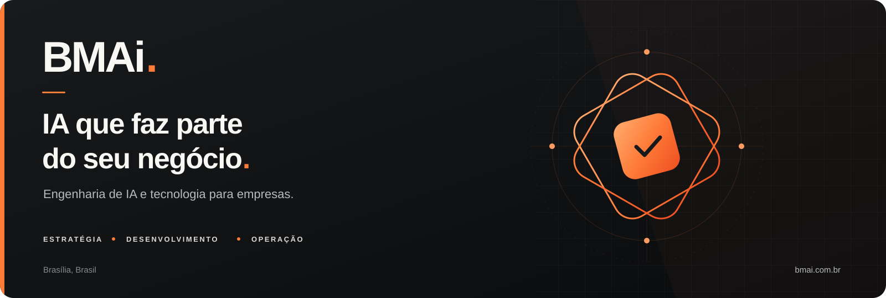

  

  <a href="https://bmai.com.br">Site institucional</a> ·
  <a href="https://bmai.com.br/servicos/">Serviços</a> ·
  <a href="https://bmai.com.br/time/">Time</a> ·
  <a href="https://bmai.com.br/contato/">Fale com a gente</a>

# Sobre a BMAi

**O time de desenvolvimento de IA e tecnologia da sua empresa.**

A BMAi é uma empresa de engenharia de inteligência artificial com sede em Brasília. Ajudamos empresas a encontrar oportunidades de IA e software que fazem sentido para o negócio, reorganizar processos e transformar essas oportunidades em soluções que o time consegue usar no dia a dia.

Nosso trabalho começa com a operação: entender onde o tempo se perde, onde o atendimento trava, como as informações circulam e quais decisões precisam de apoio. A partir disso, definimos o que vale construir, desenvolvemos a solução, conectamos às ferramentas existentes e acompanhamos a adoção.

A tecnologia precisa devolver tempo às pessoas, apoiar a receita e tornar a operação mais organizada. O objetivo é que a empresa tenha processos claros e que seu time saiba usar a solução com autonomia.

## Explore esta apresentação

| Quero conhecer… | Onde encontrar |
|---|---|
| A empresa, seu posicionamento e sua liderança | [Quem somos](docs/QuemSomos.md) |
| Os formatos de trabalho e o processo de entrega | [Serviços e método](docs/ServicosEMetodo.md) |
| Exemplos de aplicação de IA e software | [Soluções](docs/Solucoes.md) |
| Projetos apresentados publicamente pela BMAi | [Cases](docs/Cases.md) |
| Como começar e dúvidas frequentes | [Perguntas frequentes](docs/PerguntasFrequentes.md) |

## O que fazemos

Atuamos do diagnóstico à entrega e ao acompanhamento. Os formatos de trabalho incluem:

| Serviço | Como ajuda a empresa |
|---|---|
| **CTO as a Service** | Liderança de tecnologia para definir arquitetura, prioridades, roadmap e decisões técnicas junto à diretoria. |
| **Terceirização do time de TI** | Desenvolvimento, infraestrutura, segurança e suporte, com processos e responsabilidades definidos conforme o escopo. |
| **Consultoria de tecnologia estratégica** | Avaliação da operação e das ferramentas para identificar oportunidades de IA e tecnologia e construir um plano de execução. |

Dentro desses formatos, desenvolvemos aplicações, agentes de IA, integrações e automações orientadas aos processos de cada empresa.

## Onde a IA pode fazer diferença

- **Atendimento:** responder dúvidas recorrentes, orientar clientes, coletar informações e encaminhar casos para a equipe.
- **Comercial:** apoiar a descoberta de oportunidades, a organização de contatos e a qualificação de leads.
- **Operação:** reduzir tarefas repetitivas, conectar sistemas e organizar informações para o trabalho diário.
- **Gestão:** reunir dados em aplicações e painéis que ajudam as pessoas a acompanhar a operação.
- **Conhecimento:** transformar informações dispersas em uma base de consulta útil para o time.

Cada aplicação parte de um problema concreto. Canais, integrações, funcionalidades e critérios de sucesso são definidos no diagnóstico e no escopo do projeto.

## Nosso método

| Etapa | O que acontece | O que a empresa leva |
|---|---|---|
| **1. Mapeamento** | Entendemos o trabalho com quem executa os processos. | Diagnóstico, gargalos e oportunidades priorizadas por impacto e esforço. |
| **2. Reestruturação** | Redesenhamos os fluxos que precisam mudar antes da tecnologia. | Processos mais claros, responsabilidades e uma base preparada para a solução. |
| **3. Desenvolvimento** | Planejamos, construímos, integramos e testamos. | Solução sob medida e fluxos validados antes da entrada na operação. |
| **4. Acompanhamento** | Treinamos as pessoas e ajustamos a solução com o uso. | Apoio à adoção e maior autonomia do time. |

[Conheça o método em detalhes →](docs/ServicosEMetodo.md)

## Soluções e experiência

A experiência apresentada pela BMAi inclui agentes de atendimento e prospecção, aplicações para acompanhar a operação, integração de ferramentas e projetos de presença digital e dados.

O **App BMAi** reúne recursos para gestão e acompanhamento dos agentes contratados pelos clientes. Ele faz parte de uma abordagem que combina a solução de IA com a organização e a visibilidade necessárias para utilizá-la no dia a dia.

Saúde, marketing, construção, engenharia e alimentação estão entre os segmentos presentes nos projetos e cases apresentados pela empresa.

[Veja exemplos de soluções →](docs/Solucoes.md)

## Projetos apresentados no nosso site

| Projeto | Tema apresentado |
|---|---|
| **GastroObesi** | Organização do CRM e IA no atendimento de uma clínica. |
| **Só Hydráulica** | IA aplicada ao atendimento, à prospecção e à operação de uma loja de materiais. |
| **MGP Engenharia** | Presença digital, dados e segurança. |
| **O Canto** | Gestão de estoque com apoio de IA. |
| **Espaço Gourmet** | Atendimento no WhatsApp para dúvidas e solicitações de reserva. |

Os exemplos descrevem projetos específicos. Consulte os cases públicos para conhecer o contexto de cada implementação.

[Conheça os cases →](docs/Cases.md)

## Quem faz a BMAi

A BMAi foi fundada por **Matheus Brugin** e **Pedro Coelho**. A liderança da empresa reúne:

| Pessoa | Papel |
|---|---|
| Matheus Brugin | CEO |
| Pedro Coelho | CRO |
| Thiago Braziellas | CTO |
| Lucca | COO |

[Conheça a empresa e a liderança →](docs/QuemSomos.md)

## Como começar

A primeira conversa serve para entender o problema e o contexto. É útil trazer uma descrição do processo atual, onde o trabalho acumula, quais ferramentas já são utilizadas e o que você espera melhorar.

Com esse ponto de partida, avaliamos as oportunidades, o escopo e a melhor forma de trabalhar juntos. Prazos e entregas são alinhados de acordo com a complexidade de cada projeto.

**[Conte sobre o seu projeto →](https://bmai.com.br/contato/)**

## Acompanhe a BMAi

- [Site institucional](https://bmai.com.br)
- [Blog](https://bmai.com.br/blog/)
- [Radar de notícias](https://bmai.com.br/radar/)
- [LinkedIn](https://www.linkedin.com/company/bmaicompany/)
- [Instagram](https://instagram.com/bmai.oficial)
- [Contato comercial](https://bmai.com.br/contato/)

---

Este é um repositório de apresentação institucional. O conteúdo foi preparado a partir dos canais públicos da BMAi e de descrições de produto, com foco em informações que podem ser compartilhadas.

BMAi · Brasília, Brasil · [bmai.com.br](https://bmai.com.br)
